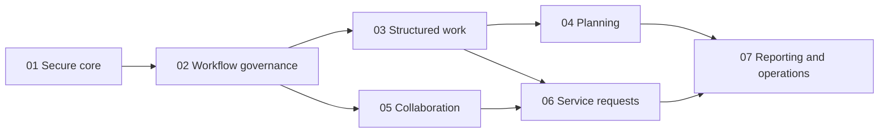

# Proposed development roadmap

Research draft, 2026-10-21. Phase 01 is authorized for new projects under the [integration decision](../changes/2026-10-21-secure-core.md); Phases 02–07 remain **proposed and unapproved**. This roadmap does not by itself describe implementation progress. Evidence labels and boundaries: [OVERVIEW](OVERVIEW.md).

## Why these seven milestones

A useful core requires identity, project isolation and an executable ticket lifecycle together. Rich workflow configuration comes after that usable baseline. Hierarchy/configurable fields, planning and collaboration then add separately testable capabilities. Service requests must wait for reliable audience and delivery controls. Advanced reporting comes after the relevant historical facts exist. This breakdown follows dependencies rather than a target phase count.

| Phase                                               | Objective and working milestone                                                                            | Prerequisites                                                             | Explicitly deferred                                                                |
| --------------------------------------------------- | ---------------------------------------------------------------------------------------------------------- | ------------------------------------------------------------------------- | ---------------------------------------------------------------------------------- |
| [01 — Secure core](phases/PHASE_01.md)              | Staff can sign in, administer a project, create/assign/transition/resolve/reopen work and inspect history. | None                                                                      | Graph editor, custom fields, hierarchy, Scrum, collaboration files/mail, customers |
| [02 — Workflow governance](phases/PHASE_02.md)      | Managers publish safe workflows, gate review/QA/approval and migrate work explicitly.                      | 01                                                                        | Type routing, arbitrary scripts, service clocks                                    |
| [03 — Structured work](phases/PHASE_03.md)          | Teams organize typed/hierarchical/linked/confidential work with validated fields and workflow bindings.    | 01–02                                                                     | Cross-project moves, arbitrary hierarchy, service portal                           |
| [04 — Planning](phases/PHASE_04.md)                 | Planners maintain backlog/boards, run one sprint per board and inspect workload/scope history.             | 01–03                                                                     | Portfolio planning, parallel sprints, full JQL                                     |
| [05 — Collaboration](phases/PHASE_05.md)            | Staff comment, attach evidence, label, mention, watch and receive retryable notifications.                 | 01–02; integrate 03 visibility when enabled                               | Customer portal, inbound email, realtime co-editing                                |
| [06 — Service requests](phases/PHASE_06.md)         | Customers submit scoped requests; agents triage/reply/approve against explicit service goals.              | 01–03, 05; 04 optional                                                    | Asset/CMDB, on-call, full incident/change operations, email ingestion              |
| [07 — Reporting and operations](phases/PHASE_07.md) | Authorized users obtain reproducible reports; operators validate retention/recovery/deployment readiness.  | 01–06 for full scope; feature-specific reports require their owning phase | Marketplace ecosystem, data warehouse, enterprise federation                       |

Phases are independently reviewable, not dependency-free. Phase 05 can be developed before 03–04 if its scope is restricted to project visibility; enabling Phase 03 later requires regression checks through comments/downloads/notifications. Do not postpone security until Phase 07: baseline isolation, private storage, audits and transactional writes belong to each owning phase.

## Shared phase gate

1. Review the owning phase's complete user process, data ownership, P defaults and unresolved decisions.
2. Confirm dependencies and any requested changes; retain O/D/P/U distinctions.
3. Approve a phase-specific requirement set, starter schema, acceptance criteria and test dataset.
4. Issue explicit development authorization. A file's existence or this roadmap is not authorization.
5. Implement only that approved phase with original code; demonstrate its acceptance scenarios and operational limits.

Each phase file includes functional requirements, process, business rules, table ownership, dependencies, deliverables, acceptance scenarios and deferred work. Shared schema conventions are in [DOMAIN_MODEL](DOMAIN_MODEL.md); phase-local tables and decisions are repeated at useful summary level.

## Technology and dependency staging (P)

| Stage | Necessary capability                                                                  | Dependency policy                                                                                                                                                                                                                    |
| ----- | ------------------------------------------------------------------------------------- | ------------------------------------------------------------------------------------------------------------------------------------------------------------------------------------------------------------------------------------ |
| 01    | Laravel, Vue 3/TypeScript/Inertia, MySQL, Tailwind/shadcn-vue, Pest/Vitest/Playwright | Supported compatible stable versions; confirm current official versions at build time. No tenancy or workflow-engine package by default.                                                                                             |
| 02–04 | Workflow validation, typed fields, graph/list views, search/planning                  | Use application rules and MySQL first; a visual graph library is optional and not required for functional configuration.                                                                                                             |
| 05    | Background delivery and private storage                                               | Laravel queue/mail/filesystem primitives; database queue initially. A real mail transport and upload validation policy are required before enabling those features. Antivirus service only if the approved threat model requires it. |
| 06    | Scheduler and timezone-aware service calculations                                     | Existing workers/scheduler; no separate rules engine required. Evaluate a business-calendar dependency only if well-tested native date handling is insufficient.                                                                     |
| 07    | Export, monitoring, deployment and recovery                                           | Docker is the proposed deployment direction, pending explicit future approval. No Docker setup is included in this research. A CSV export can use native streaming; additional renderers/services require a concrete need.           |

No dependency installation, upgrade or application code is part of this deliverable. No AI, autonomous operation or document automation is planned.

## Success and known limits

The proposed product is functionally complete for the bounded scope when staff and customers can follow their respective authorized lifecycles, configuration changes preserve traceability, planning history supports declared metrics, and failures do not leak or corrupt data. It is not Jira feature parity or an API-compatible replacement.

Authenticated tenant validation remains outstanding for the source investigation. See U01–U05 in [OVERVIEW](OVERVIEW.md#remaining-investigation-and-review). Research may be reviewed now; claims of observed tenant behavior require that additional evidence.
