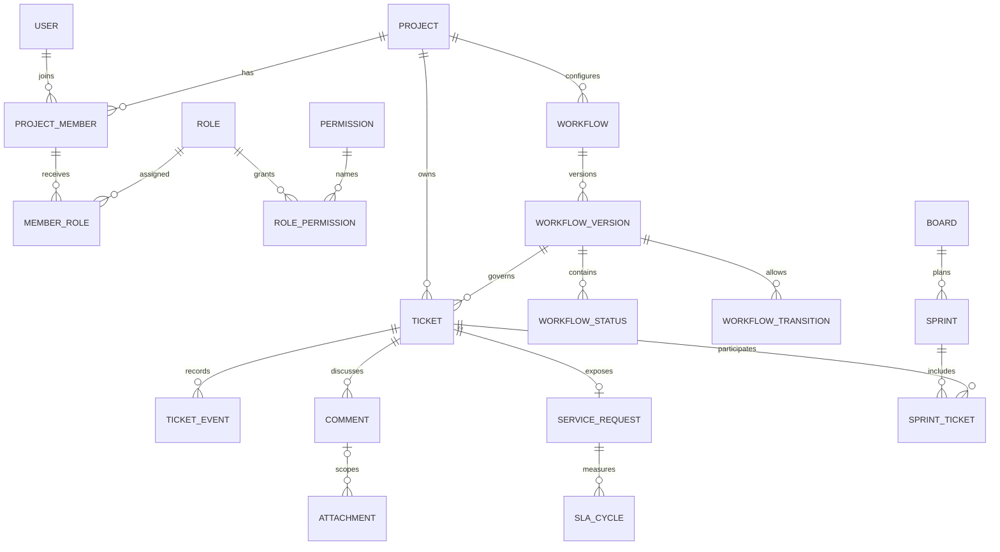

# Proposed domain and MySQL model

Status: P — original design for review, not Jira's internal schema. Jira's public entities and APIs suggest responsibilities, not database columns. D evidence is cataloged in [OVERVIEW](OVERVIEW.md); execution flows are in [PROCESS_FLOWS](PROCESS_FLOWS.md). No schema below is approved for migration.

## Canonical language

| Term                               | Meaning and boundary                                                                                                                               |
| ---------------------------------- | -------------------------------------------------------------------------------------------------------------------------------------------------- |
| Account                            | Login identity; suspension affects all of its access. It is distinct from project membership.                                                      |
| Project                            | Authorization and configuration boundary that owns tickets; called a space in some current Cloud documentation.                                    |
| Member / role / permission         | A member belongs to a project; a role groups capabilities; a permission names one capability. A job title never authorizes an action.              |
| Team                               | Reusable grouping for coordination; membership alone never grants project access.                                                                  |
| Ticket                             | Internal work record with stable project number, type, state and history; Jira may call it an issue or work item.                                  |
| Request                            | Customer-facing projection of one ticket, governed by portal access and request-type fields.                                                       |
| Work type / request type           | Work type classifies internal execution. Request type is a customer intake contract mapped to a work type.                                         |
| Status / category / resolution     | Status is a workflow location; category is broad todo/in-progress/done semantics; resolution explains a terminal outcome. Priority is independent. |
| Workflow version / transition      | An immutable published graph / one allowed directed edge with its rule set.                                                                        |
| Requirement revision / stage visit | Version of material ticket requirements / a particular entry into a status, including repeated entries.                                            |
| Approval                           | Decision by an eligible person for one requirement revision and visit; distinguish from testing evidence or generic comments.                      |
| Parent / link                      | A hierarchical ownership relationship / a typed relation such as blocks or duplicates. They are not interchangeable.                               |
| Board / queue / filter             | Status-column view / service triage view / saved selection criteria. None owns copies of tickets or grants access.                                 |
| Sprint                             | A bounded planning interval with scope history; membership differs from ticket status.                                                             |
| Estimate / work log                | Expected effort / recorded effort. Neither is elapsed delivery time.                                                                               |
| Activity / audit / notification    | Ticket business history / administrative-security history / delivery of an event to an authorized audience.                                        |
| SLA cycle                          | One timed obligation against a pinned policy and business calendar; reopening does not rewrite a past cycle.                                       |

## Relationships

## Shared storage rules

- MySQL supported stable release, InnoDB, `utf8mb4`; `BIGINT UNSIGNED` surrogate IDs unless a pivot has a natural composite key. Store instants in UTC with microseconds; due dates are `DATE`; calendars store IANA timezone names.
- Ordinary mutable rows have `created_at`, `updated_at`; tickets/configurations exposed to concurrent edits have `lock_version`. Immutable events have `occurred_at`, `recorded_at`, actor, event type and correlation ID. Actor references remain after suspension; anonymization requires a separate retention decision.
- Every project-owned entity carries `project_id`. Add unique `(id, project_id)` on referenced parents; use composite FKs on module/type/role/ticket/parent/board/sprint relations to block cross-project writes. A status and transition must also match the ticket's workflow version. Validate active membership and permissions transactionally because FKs cannot enforce them.
- Optional references are nullable; required state is never represented with an invented zero ID. Restrict deletion of referenced configurations/history. Archive or retire catalogs without breaking past records.
- Native `JSON` holds bounded rule arguments, criteria and snapshots, not core foreign keys or arbitrary executable expressions. Validate shapes and schema versions. Do not place credentials or private comment bodies in broadly visible audit payloads.
- Allocate ticket numbers by row-locking `project_counters` in the create transaction; unique `(project_id, number)` is the backstop. Never reuse numbers or use `MAX(number)+1` for live allocation.
- Per-user visibility is applied before pagination, totals and exports. Search indexes/caches retain scope and must not outlive authorization changes without rechecking.

## Phase 01 — Identity, project and basic work

`projects` additionally stores a required validated IANA `timezone`, with UTC as the proposed default; overdue calculations use it rather than the server's local timezone.

Unless stated otherwise, each row below has `id` plus the shared timestamps. `?` means nullable. These are minimum starting fields; approved implementation must set exact lengths/checks and migration ordering.

| Table                               | Starting fields and relationships                                                                                                                                                                                                                                                      | Keys / integrity                                                                                                 |
| ----------------------------------- | -------------------------------------------------------------------------------------------------------------------------------------------------------------------------------------------------------------------------------------------------------------------------------------- | ---------------------------------------------------------------------------------------------------------------- |
| `users`                             | name, normalized_email, password_hash?, state, email_verified_at?, suspended_at?                                                                                                                                                                                                       | Unique email; retain historical identity                                                                         |
| `account_invitations`               | user_id, token_hash, expires_at, accepted_at?, invited_by                                                                                                                                                                                                                              | Unique token hash; single-use consumption                                                                        |
| `sessions`, `password_reset_tokens` | Framework-managed user/session and hashed reset-token records                                                                                                                                                                                                                          | Framework schema; revoke on suspension                                                                           |
| `permissions`                       | key, scope(global/project), description                                                                                                                                                                                                                                                | Unique key; immutable capability meaning                                                                         |
| `global_user_permissions`           | user_id, permission_id, granted_by                                                                                                                                                                                                                                                     | PK(user_id, permission_id); scope global only                                                                    |
| `projects`                          | code, name, description?, state, created_by, archived_at?, lock_version                                                                                                                                                                                                                | Unique immutable code                                                                                            |
| `project_members`                   | project_id, user_id, state                                                                                                                                                                                                                                                             | Unique(project_id, user_id), unique(id, project_id)                                                              |
| `roles`                             | project_id, name, description?, retired_at?                                                                                                                                                                                                                                            | Unique(project_id, name)                                                                                         |
| `member_roles`                      | project_id, member_id, role_id                                                                                                                                                                                                                                                         | PK(member_id, role_id); both references same project                                                             |
| `role_permissions`                  | role_id, permission_id                                                                                                                                                                                                                                                                 | PK(role_id, permission_id); project capabilities only                                                            |
| `components`                        | project_id, code, name, state                                                                                                                                                                                                                                                          | Unique(project_id, code)                                                                                         |
| `work_types`                        | project_id, code, name, state                                                                                                                                                                                                                                                          | Unique(project_id, code); configurable starter types                                                             |
| `priorities`                        | project_id, code, name, rank, state                                                                                                                                                                                                                                                    | Unique(project_id, code)                                                                                         |
| `resolutions`                       | project_id, code, name, outcome(success/cancel/duplicate/other), state                                                                                                                                                                                                                 | Unique(project_id, code)                                                                                         |
| `workflows`                         | project_id, name, state                                                                                                                                                                                                                                                                | Unique(project_id, name)                                                                                         |
| `workflow_versions`                 | project_id, workflow_id, number, state(draft/published/retired), published_by?, published_at?                                                                                                                                                                                          | Unique(workflow_id, number), unique(id, project_id)                                                              |
| `workflow_statuses`                 | project_id, workflow_version_id, key, name, category, is_initial, is_terminal, position                                                                                                                                                                                                | Unique(version, key), unique(id, workflow_version_id, project_id)                                                |
| `workflow_transitions`              | project_id, workflow_version_id, key, from_status_id, to_status_id, required_permission_id?, sets_resolution                                                                                                                                                                           | Unique(version, key); endpoint composite FKs                                                                     |
| `project_workflow_bindings`         | project_id, binding_key(default initially), workflow_version_id, effective_at                                                                                                                                                                                                          | Unique(project_id,binding_key); stores current binding, changes retained in audit/events                         |
| `project_counters`                  | project_id(PK), next_number                                                                                                                                                                                                                                                            | Locked allocator                                                                                                 |
| `tickets`                           | project_id, number, work_type_id, priority_id, summary, description, acceptance_criteria(JSON)?, reporter_id, assignee_id?, component_id?, workflow_version_id, status_id, resolution_id?, resolved_at?, estimate_minutes?, due_date?, requirement_revision, stage_visit, lock_version | Unique(project_id, number); scoped FKs; indexes(project,status,id), (project,assignee,id), (project,due_date,id) |
| `ticket_events`                     | project_id, ticket_id, actor_id, type, before_json?, after_json?, requirement_revision, stage_visit, occurred_at, recorded_at, correlation_id                                                                                                                                          | Append-only; index(ticket_id,id); actor/time cannot be changed by ordinary users                                 |
| `audit_events`                      | project_id?, actor_id?, action, entity_type, entity_id, safe_delta(JSON), occurred_at, correlation_id                                                                                                                                                                                  | Append-only, restricted read; index(project_id,occurred_at,id)                                                   |

P01 creates one seeded published graph per project, so ticket writes always reference explicit versions. It provides no graph editor. Proposed starter states and work types are editable catalog data in later phases, not Jira claims.

## Phase 02 — Workflow rules and migration

Checkpoint configuration also stores `mandatory_for_outcomes` as validated outcome keys, `gate_order` and the self-approval policy. Ticket events retain invalidated checkpoint IDs plus visit cutoffs. Phase 02 defines the exact material-edit set and the approval applicability algorithm; these are proposed contracts rather than hidden implementation choices.

| Table / alteration         | Starting fields                                                                                                                                          | Integrity                                                           |
| -------------------------- | -------------------------------------------------------------------------------------------------------------------------------------------------------- | ------------------------------------------------------------------- |
| `transition_rules`         | project_id, transition_id, kind(condition/validator/effect), rule_key, arguments(JSON), position                                                         | Allowed rule catalog; rule set immutable after publication          |
| `workflow_checkpoints`     | project_id, workflow_version_id, status_id, kind(review/qa/approval), required_permission_id, required_count, reject_transition_id, forbid_self_approval | Eligible source/target versions match; no impossible gate           |
| `ticket_approvals`         | project_id, ticket_id, checkpoint_id, actor_id, requirement_revision, stage_visit, decision, note?, decided_at                                           | Unique(ticket,checkpoint,revision,visit,actor); no duplicated votes |
| `workflow_migration_runs`  | project_id, from_version_id, to_version_id, mapping(JSON), actor_id, state, reason                                                                       | Immutable approved mapping; bounded batch state                     |
| `workflow_migration_items` | run_id, ticket_id, expected_lock_version, from_status_id, to_status_id, result, error_code?                                                              | Unique(run,ticket); preserve lineage/retry result                   |

## Phase 03 — Structured work, teams and visibility

| Table / alteration                        | Starting fields                                                                                                   | Integrity                                                                                                                     |
| ----------------------------------------- | ----------------------------------------------------------------------------------------------------------------- | ----------------------------------------------------------------------------------------------------------------------------- |
| `teams`, `team_members`, `project_teams`  | team(name,state); joins(team,user) and (project,team)                                                             | Unique joins; team does not grant access                                                                                      |
| `tickets` additions                       | parent_ticket_id?, team_id?                                                                                       | Scoped parent FK, server cycle/depth checks                                                                                   |
| `work_types` addition                     | hierarchy_level(epic/standard/subtask)                                                                            | Allowed parent-level matrix                                                                                                   |
| `ticket_components`                       | project_id, ticket_id, component_id                                                                               | PK(ticket,component); replaces single optional component after backfill                                                       |
| `release_versions`, `ticket_releases`     | release(project,name,state,target_date?,released_at?); join(project,ticket,release,relation)                      | Unique(project,name), unique(ticket,release,relation)                                                                         |
| `link_types`, `ticket_links`              | type(project,key,outward_label,inward_label,directional); link(project,source_ticket_id,target_ticket_id,type_id) | Unique edge; no self-edge; canonical ordering for symmetric links                                                             |
| `field_definitions`, `field_options`      | definition(project,key,type,required,state); option(project,field,key,label,state)                                | Unique(project,key), unique(field,key); type frozen after use                                                                 |
| `type_fields`                             | project_id, work_type_id, field_id, required, position                                                            | Unique(type,field); enabled-field contract                                                                                    |
| `ticket_field_values`                     | project_id, ticket_id, field_id, text_value?, decimal_value?, date_value?, boolean_value?, option_id?             | Unique(ticket,field); exactly one typed value for populated field; options belong to field                                    |
| `project_workflow_bindings` addition      | work_type_id?, binding_key(default or type:<id>)                                                                  | Unique(project,binding_key); require consistent key/type identity and scoped type FK; never rely on nullable uniqueness alone |
| `security_levels`, `security_level_roles` | level(project,key,name); join(project,level,role)                                                                 | Unique(project,key); same-project roles only                                                                                  |
| `tickets` addition                        | security_level_id?                                                                                                | Access narrows project visibility; subtasks cannot widen parent scope                                                         |

Keep only single-select, text, decimal, date and boolean custom fields initially. Retired fields/options remain readable. A type change validates fields, parent level and workflow binding as one operation.

## Phase 04 — Planning

| Table / alteration                       | Starting fields                                                                                                                                                 | Integrity                                                                                                                       |
| ---------------------------------------- | --------------------------------------------------------------------------------------------------------------------------------------------------------------- | ------------------------------------------------------------------------------------------------------------------------------- |
| `saved_filters`, `filter_shares`         | filter(project,owner,name,criteria(JSON),sort(JSON),lock_version); share(filter,role)                                                                           | Sharing grants filter read only; bounded structured operators                                                                   |
| `boards`                                 | project_id, name, kind(kanban/scrum), filter_id, estimation_unit, lock_version                                                                                  | Filter same project; one declared unit per board                                                                                |
| `board_columns`, `board_column_statuses` | column(project,board,key,name,position,wip_max?); mapping(project,board,column,status)                                                                          | Status at most one column per board, allow several statuses in column                                                           |
| `backlog_ranks`                          | project_id, board_id, ticket_id, rank                                                                                                                           | Unique(board,ticket) and unique(board,rank); serialize reorder/rebalance                                                        |
| `sprints`                                | project_id, board_id, name, goal?, state, planned_start?, started_at?, planned_end?, completed_at?, lock_version                                                | Indexed(board,state); one active sprint per board by serialized start                                                           |
| `sprint_tickets`, `sprint_events`        | membership(project,sprint,ticket,added_at,removed_at?,start_snapshot(JSON)?,completion_snapshot(JSON)?); event(project,sprint,ticket?,type,payload,occurred_at) | Historical memberships retained; at most one current future/active sprint per ticket; snapshots preserve estimates and outcomes |
| `work_logs`                              | project_id, ticket_id, user_id, minutes, started_at, note?, revision, voided_at?                                                                                | Positive minutes; audited edits/voids                                                                                           |
| `work_log_revisions`                     | work_log_id, editor_id, previous_values(JSON), revision, occurred_at                                                                                            | Unique(work_log,revision); append-only edit/void history                                                                        |
| `tickets` addition                       | story_points(DECIMAL)?                                                                                                                                          | Optional, nonnegative; never converted to minutes                                                                               |

## Phase 05 — Collaboration and delivery

| Table                                      | Starting fields                                                                                                                                           | Integrity                                                                              |
| ------------------------------------------ | --------------------------------------------------------------------------------------------------------------------------------------------------------- | -------------------------------------------------------------------------------------- |
| `comments`, `comment_revisions`            | comment(project,ticket,author,audience,body,lock_version,deleted_at?); revision(comment,editor,body,audience,occurred_at)                                 | Internal/customer audience mandatory; history restricted                               |
| `attachments`                              | project_id, ticket_id, comment_id?, uploader_id, disk, object_key, original_name, detected_mime, bytes, state(staged/ready/quarantined/deleted), audience | Unique(disk,object_key); comment/ticket match; private storage                         |
| `labels`, `ticket_labels`                  | label(project,name); join(project,ticket,label)                                                                                                           | Unique(project,name), unique(ticket,label)                                             |
| `ticket_watchers`, `comment_mentions`      | watcher(project,ticket,user); mention(project,comment,user)                                                                                               | Unique pairs; recheck visibility on lookup/delivery                                    |
| `outbox_events`                            | project_id, aggregate_type, aggregate_id, event_key, audience, safe_payload, committed_at, available_at, state                                            | Unique event_key; written with domain transaction                                      |
| `notifications`, `notification_deliveries` | notification(project,event,user,type,read_at?); delivery(notification,channel,state,attempts,next_attempt_at?,last_error_code?)                           | Unique(event,user,type); unique(notification,channel)                                  |
| `user_notification_preferences`            | user_id, event_category, channel, enabled                                                                                                                 | Unique(user,event_category,channel); mandatory security messages excluded from opt-out |

## Phase 06 — Service requests

Request-type versions include a same-project `default_priority_id` FK. Request field rows distinguish native field keys from same-project custom-field IDs and declare the input mapping. Add `request_type_defaults` with request_type_version_id, project_id, custom_field_id and the same typed value columns as ticket_field_values; unique(version,field), validate option ownership and reject defaults inconsistent with the work type. Publishing requires public fields plus defaults to satisfy all required internal fields.

Each SLA policy version owns `sla_goals` rows: project_id, policy_version_id, key, rank, match_criteria(JSON), target_seconds and calendar_version_id. Unique(version,key/rank), composite calendar FK, explicit first-match order; cycles store `sla_goal_id` as well as pinned policy/calendar references. Add `service_clock_sources`: id, project_id, source_key(unique), kind(ticket/project-lifecycle/recalculation), ticket_event_id?, audit_event_id?, occurred_at, recorded_at. Validate source-kind/reference consistency; explicit recalculation has its own durable source key. `sla_clock_events` references `source_id`, not only ticket_event_id, and is unique(cycle,source,kind). This covers archive/restore/recalculation provenance and replay.

Each `sla_cycles` row also stores `cycle_number` and nullable `previous_cycle_id`; enforce unique(request, policy, cycle_number) and same-request lineage so reopen history is explicit. Request and clock event occurrence timestamps are distinct from worker processing timestamps.

| Table / alteration                                              | Starting fields                                                                                                                                                          | Integrity                                                                                                    |
| --------------------------------------------------------------- | ------------------------------------------------------------------------------------------------------------------------------------------------------------------------ | ------------------------------------------------------------------------------------------------------------ |
| `project_customers`                                             | project_id, user_id, state                                                                                                                                               | Unique(project,user); distinct from staff membership                                                         |
| `request_types`, `request_type_versions`, `request_type_fields` | type(project,key,name,state); version(project,request_type,number,work_type_id,state,published_at); field(project,request_type_version,field_key,required,position)      | Unique(type,number); published field contract immutable; no arbitrary internal IDs                           |
| `service_requests`, `request_participants`                      | request(project,ticket_id,request_type_version_id,customer_id,channel); participant(project,request,user)                                                                | Unique(ticket_id); customer/participant belongs to project customer scope                                    |
| `portal_status_mappings`                                        | project_id, request_type_version_id, workflow_status_id, public_label                                                                                                    | Unique(request_type_version,status); no hidden internal state text fallback                                  |
| `request_approvers`                                             | project_id, request_id, checkpoint_id, requirement_revision, stage_visit, user_id, eligibility_state                                                                     | Unique(request,checkpoint,revision,visit,user); explicit eligibility snapshot, decisions in ticket_approvals |
| `service_queues`                                                | project_id, name, criteria(JSON), columns(JSON), sort(JSON)                                                                                                              | Scoped view; stable sort tie-breaker                                                                         |
| `sla_policies`, `sla_policy_versions`                           | policy(project,key,name); version(policy,number,state,goal_rows(sla_goals),start_pause_stop_rules(JSON),published_at)                                                    | Unique(policy,number); immutable published rules                                                             |
| `business_calendars`, `calendar_versions`                       | calendar(project,name); version(calendar,number,timezone,weekly_intervals(JSON),holidays(JSON),published_at)                                                             | Unique(calendar,number); validate overlap and DST policy                                                     |
| `sla_cycles`, `sla_clock_events`                                | cycle(project,request,policy_version,calendar_version,target_seconds,elapsed_seconds,state,started_at,stopped_at?,breached_at?); event(cycle,source_id,kind,occurred_at) | Unique(cycle,source_id,kind); past results immutable                                                         |
| `ticket_approvals` integration                                  | eligible customer approvers scoped to request and checkpoint                                                                                                             | Never infer staff access from approver eligibility                                                           |

Email ingestion, inbound webhook integrations and organization-wide sharing are deliberately outside this starting schema. They require separate identity/deduplication/security contracts before inclusion.

## Phase 07 — Reporting and operational governance

| Table                                 | Starting fields                                                                                                                | Integrity                                                  |
| ------------------------------------- | ------------------------------------------------------------------------------------------------------------------------------ | ---------------------------------------------------------- |
| `dashboards`, `dashboard_widgets`     | dashboard(project,owner,name,sharing); widget(project,dashboard,type,filter_id?,configuration(JSON),position)                  | Viewer-specific scope enforced before aggregation          |
| `report_definitions`, `report_series` | report(project,owner,name,metric_version,timezone); series(project,report,metric_key,criteria(JSON),label)                     | Allowlisted metrics; bounded series/windows                |
| `report_runs`, `report_exports`       | run(project,report,requested_by,as_of,parameters,dataset_scope_digest,state); export(run,private_object_key,state,expires_at?) | Scope-aware cache keys; authorized private retrieval       |
| `settings`, `setting_revisions`       | setting(scope,project_id?,key,value_json,revision); revision(setting,actor,safe_delta,occurred_at)                             | Scope/key uniqueness; global and project settings explicit |
| `retention_runs`                      | project_id?, actor_id, policy_snapshot, cutoff, state, counts(JSON), completed_at?                                             | Preview then explicitly authorize destructive cleanup      |

Existing ticket events and audits remain authoritative. Prefer live aggregates initially. Only add materialized snapshots after measuring need and defining recomputation, permissions, retention and freshness.

## Transaction and history contracts

1. Ticket creation commits counter, ticket and creation event together; optional idempotency key prevents retry duplicates.
2. Transitions lock the ticket, compare version, authorize, validate rules/checkpoints, commit status/resolution/history; notification work starts after commit.
3. Workflow publication and binding change serialize on project/configuration; migrations preserve old identifiers and batch results.
4. Permission changes serialize their grant checks and the final-admin safeguard; audit before/after capability sets without secrets.
5. File storage is not a relational transaction: stage privately, validate, persist metadata, then finalize with compensation/retry. Downloads authorize both ticket and audience.
6. Reports derive from immutable historical events when measuring elapsed/cycle/sprint changes. Current ticket rows suffice only for current-state totals.

## Decisions requiring phase review

Approve scope of global administration, project delegation, customer onboarding, upload policy, hierarchy rules, custom-field limits, terminal semantics, checkpoint eligibility/self-approval, workflow migration, sprint completion, SLA pause/reopen policies, notification recipients, and retention periods. Proposed defaults are explicit in the owning phase; none is a recovered Jira invariant.
