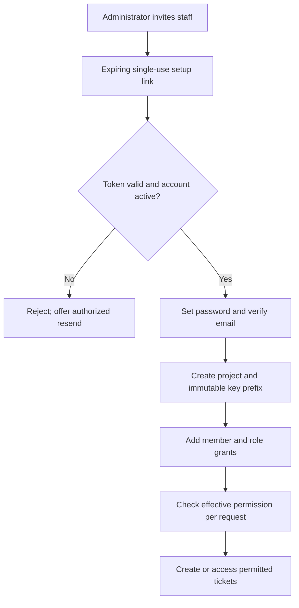
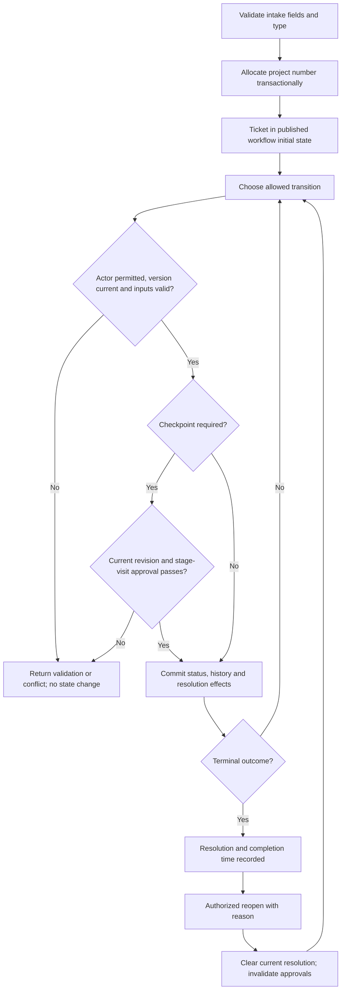
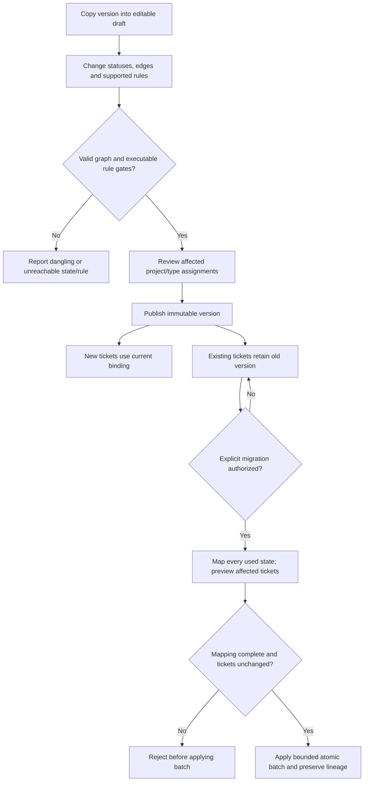

# Process flows

Draft; all normative flows below are **P: proposed original behavior**. Documented inspiration is cited per flow. O/D/P/U conventions and source IDs: [OVERVIEW](OVERVIEW.md). A failed guard must leave domain state unchanged. Every successful write records actor, timestamp and correlation ID; external delivery follows commit.

## F01 — Account, project and access onboarding (Phase 01)

Actor: global account administrator, then authorized project manager. Preconditions: active authenticated actor with the appropriate independent global/project permission.

Existing-email invitations must not create a second identity or reset an established password. Project membership alone grants no operation. A role rename changes presentation, not rights. Before self-removal or global deactivation, protect the final active administrator. Project managers cannot delegate permissions they do not possess. Deactivation revokes sessions; past ticket authorship remains. Notification delivery errors expose an actionable retry without storing raw tokens in audit.

D basis: [account lifecycle](https://support.atlassian.com/user-management/docs/deactivate-a-managed-account/), [project role isolation](https://support.atlassian.com/jira/kb/grant-access-to-single-jira-project-that-uses-a-shared-permission-scheme/). The last-admin and delegation rules are P safeguards.

## F02 — Intake, assignment, transition, completion and reopen (Phases 01–02)

Actor: permitted reporter, assignee, reviewer and closer. Preconditions: active project; visible ticket; eligible assigned user when a work transition requires assignment.

Phase 01 supplies the basic seeded transition path; configurable checkpoints and approvals activate in Phase 02. Never allow a board drag or a generic field edit to bypass this transition operation. Competing writes require a ticket lock/version check. Completion is an outcome, not merely a status name; cancellation and duplicate closure have distinct resolutions. Reopen retains the key and prior history. Missing criteria when a validator requires them, an inactive required assignee, stale approval or another failed validator blocks progression with an explanatory error. A materially changed requirement invalidates approvals for its former revision.

D basis: [status/priority/resolution](https://support.atlassian.com/jira-cloud-administration/docs/what-are-issue-statuses-priorities-and-resolutions/), [workflow rules](https://support.atlassian.com/jira-cloud-administration/docs/configure-advanced-issue-workflows/). Universal QA and a fixed Development → QA → Closed sequence are not claimed Jira requirements.

## F03 — Publish or migrate a workflow (Phases 02–03)

Actor: workflow manager. Input: draft graph and optional project/type assignment. Outcome: a validated immutable version; no implicit movement of existing tickets.

Graph checks: one initial nonterminal state, reachable allowed states, a path from each nonterminal state to an outcome, no dangling edges, and rule definitions that can actually be fulfilled. Rework loops are allowed. Migration maps stage, workflow and approvals together; it never relabels old history. Each batch is atomic, resumable and audited with old/new version IDs and mappings. A failed/stale batch commits no partial ticket changes. Versions in use cannot be deleted. Reopening a retained-version ticket uses that version until explicitly migrated.

D basis: [Cloud editor publication and status replacement](https://support.atlassian.com/jira-cloud-administration/docs/what-is-the-new-workflow-editor/). Immutable version pinning and bounded migration batches are our P design, not Atlassian internals.

## F04 — Hierarchy, relationships and confidential work (Phase 03)

Create child → verify both records visible and same project → validate allowed type levels and no cycle → record parent edge → permit independent assignment/workflow. Add a directional link only when both ends are visible. A `blocks` link is advisory until an explicit transition rule makes it enforceable. Parent closure with open children is rejected in the proposed default; allow a separately permissioned exception with reason if approved. Security-level changes propagate the parent restriction to subtasks; search counts and child listings must not reveal hidden records.

D basis: [subtasks and restrictions](https://support.atlassian.com/jira-software-cloud/docs/create-a-work-item-and-a-subtask/). Parent-close policy, same-project scope and advisory blocking default are P decisions.

## F05 — Backlog, board and sprint (Phase 04)

Actor: planner for ordering/sprint management, permitted worker for transition. Create/share a structured filter → evaluate it under the viewer's current permissions → map statuses to columns → rank eligible work → select sprint scope → start → work through authorized transitions → complete sprint and explicitly carry unfinished work to backlog or a future sprint.

If a drop target has multiple valid statuses, require a selected allowed transition rather than guessing. Reject invalid or stale drops; ranking never changes status. Capture sprint scope at start and scope changes afterward, with original estimates and a declared completion rule. An empty filter, unmapped status or hidden item must be explainable without disclosing unauthorized tickets. Current filters cannot rewrite historical membership facts.

D basis: [columns](https://support.atlassian.com/jira-software-cloud/docs/configure-columns/), [team-managed sprints](https://support.atlassian.com/jira-software-cloud/docs/enable-sprints/). Our simpler completion rule uses terminal status-category plus explicit resolution, rather than copying Jira's right-most-column completion semantics.

## F06 — Comment, mention, upload and notify (Phase 05)

Private attachments inherit the associated comment's audience; unattached internal uploads remain staff-only. Before linking temporary uploads, authorize ownership and scope. If validation fails, staged files expire or are cleaned up; do not leave a downloadable orphan. Internal content never appears in customer projections. Revoked members cannot receive later message bodies. Message IDs suppress duplicate internal processing; external mail can still duplicate after a crash between provider acceptance and acknowledgement, so record that limitation. Mentions never grant membership. Editing or deleting content records a revision/tombstone under the retention policy.

D basis: [JSM comments](https://support.atlassian.com/jira-service-management-cloud/docs/talk-to-the-customer-or-team-members-from-the-new-issue-view/), [notification audiences](https://support.atlassian.com/jira-service-management-cloud/docs/what-notifications-do-my-customers-and-service-desk-team-receive/). Outbox and retry semantics are P.

## F07 — Customer request and service timer (Phase 06)

Customer authenticates → chooses request type → server validates only allowed intake fields → creates one internal ticket and one request projection atomically → agents triage via queues → customer receives public replies/status → authorized resolution/reopen.

The customer can see own requests or explicit participation only; organization-wide sharing is deferred. Customer-provided assignee, internal status, security level or role IDs are ignored/rejected. The customer-facing state maps from internal states; it does not disclose every review stage. Approval-only access reveals the minimum request context and never confers agent access.

SLA: create cycle from a versioned policy/calendar → start when its event matches → count business intervals → pause/resume on defined events → stop on target event → retain result and breach. Reopen creates a new cycle under the approved policy; it never erases a prior breach. Handle events idempotently in occurrence order and distinguish occurrence from processing time. Calendar timezone and DST rules govern elapsed business time. Archived projects stop accepting new work; active timers pause with an audit event until restore under the proposed default.

D basis: [request types](https://support.atlassian.com/jira-service-management-cloud/docs/manage-your-request-types-and-ticket-categories/), [calendars](https://support.atlassian.com/jira-service-management-cloud/docs/set-up-sla-calendars/), [goals](https://support.atlassian.com/jira-service-management-cloud/docs/set-up-sla-goals/). Cycle snapshot/reopen/archive rules are P.

## F08 — Archive, restore and reporting (Phases 01, 07)

An authorized manager archives a project with a reason → business writes stop, including worker-driven domain changes → default active lists omit it → permitted direct reads/history remain → restore is separately authorized and audited. In Phase 06, archive additionally records timer pauses. Retention cleanup is a separate privileged process, not an archive side effect.

Viewer requests report → apply ticket and comment security predicates → bound date window in an explicit timezone → compute documented metric → show sample/empty/freshness state → export only if separately authorized. Retention or anonymization must preserve required metric lineage without retaining prohibited personal data. Access changes invalidate cached viewer results. A dashboard is never authority to read its underlying tickets.

D basis: [archive](https://support.atlassian.com/jira-cloud-administration/docs/archive-a-project/), [reports](https://support.atlassian.com/jira-service-management-cloud/docs/create-a-new-custom-report/), [audit](https://support.atlassian.com/jira-cloud-administration/docs/audit-activities-in-jira-applications/).
